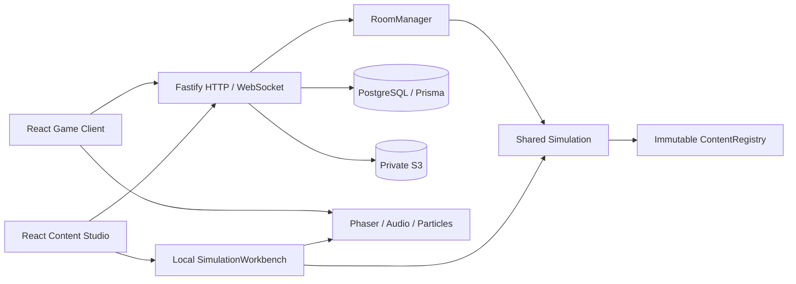

# Фактическая архитектура

Game Client и Editor — две Vite/React-сборки. Fastify выдаёт публичный клиент из `dist/game` и проверяет административную сессию перед выдачей `dist/editor`. Phaser Canvas загружается отдельным chunk при открытии игрового поля. Один Node-процесс исполняет комнаты с фиксированным шагом 30 Hz.

`content-schemas` задаёт TypeBox-типы и JSON Schema для 36 коллекций. `generate-validators.ts` заранее компилирует AJV-валидаторы в CommonJS; браузерная сборка включает готовые функции без `eval`. Семантическая проверка ссылок, графов, карт и ресурсов работает поверх схем. При изменении схем обязательно выполнять `npm run generate`.

`game-core` содержит RNG и геометрию; `procedural-generation` строит карты и путь; `simulation` хранит сериализуемое состояние и исполняет команды. AI сейчас находится внутри Simulation, отдельного ai-engine пока нет. `effect-engine` исполняет ограниченные декларативные графы. Trusted TypeScript extensions регистрируются при сборке. Simulation не зависит от React, Phaser, БД или сети.

Потоки RNG мира, боя и дропа разделены. Snapshot содержит версии, seed, tick, сущности, RNG, delayed commands и состояния расширений. Визуальные частицы и камера не влияют на результаты боя. `event-system` предоставляет отдельный EventBus, но текущая Simulation использует собственную очередь типизированных событий — унификация остаётся открытой.

PostgreSQL хранит пользователей, хеши сессий, комнаты, snapshots, участников, учтённые дельты статистики, unlocks, draft revisions, manifest и указатель активного контента. S3 хранит закрытые медиа и неизменяемые ZIP. Публикация записывает архив, затем транзакционно переключает указатель. Публичная раздача читает оригинальные байты ZIP: повторная сериализация JSONB изменила бы SHA-256.

Редактор использует Zustand и Dockview; UI layout/позиции узлов отделены от runtime content. Undo хранится локально до 50 состояний; autosave — 1,2 секунды. Сервер отвергает устаревшую revision с 409. При конфликте интерфейс позволяет скачать локальный draft для сохранения работы.

Ограничения: один процесс RoomManager, нет распределённого владения комнатами; состояние сохраняется раз в 150 ticks и при завершении/выходе/shutdown. Аварийное завершение может потерять последние пять секунд. Полный перечень незакрытых контрактов — в IMPLEMENTATION_STATUS.
